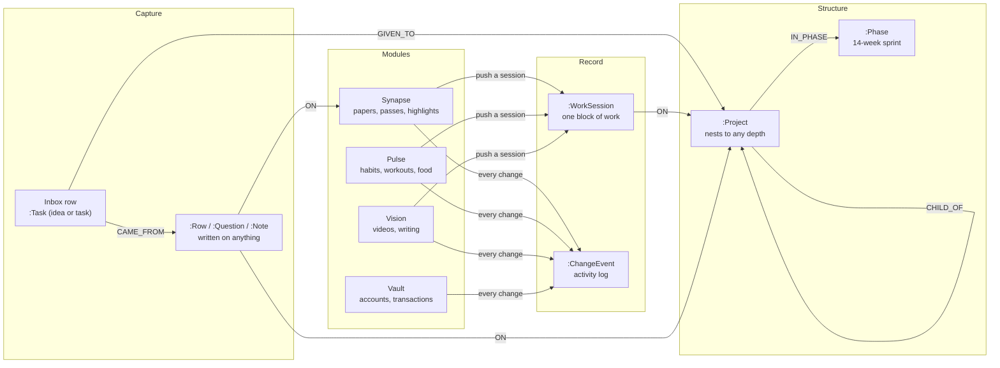

# Mainframe

A self-hosted **personal operating system**: one web app where one person runs
their research, body, money and creative output against a single graph database.

**Local-first by design.** Everything runs on your machine: a Neo4j graph, a
local LLM through Ollama, and a FastAPI server that serves both the API and the
frontend. No cloud APIs, no keys, no telemetry, and it works offline. The one
deliberate exception is resolving academic references against Crossref and
OpenAlex, which you can leave unused.

All sample content in this repository (docs, mockups, tests, demo seed) is
invented.

---

## Contents

- [Quick start](#quick-start)
- [Demo data](#demo-data)
- [How things connect](#how-things-connect)
- [How to use it](#how-to-use-it)
- [The modules and their tabs](#the-modules-and-their-tabs)
- [Where things live](#where-things-live)
- [Configuration](#configuration)
- [The stack](#the-stack)
- [Tests](#tests)
- [Further reading](#further-reading)

---

## Quick start

You need Docker, Python 3.10+, and optionally [Ollama](https://ollama.com).

```bash
./start.sh          # starts Neo4j in Docker, installs Python deps, runs the API
# open http://localhost:8000
./stop.sh           # stops both; the graph persists in a Docker volume
```

`start.sh` is safe to rerun. The first Neo4j boot takes about 20 seconds. The
schema (constraints, indexes, migrations) is created on every startup, so an
empty database is ready to use straight away.

The local model is optional:

```bash
ollama pull qwen2.5:7b-instruct     # about 4.7 GB, Apache-2.0
```

Without Ollama the app still works. Paper ingestion falls back to a built-in
heuristic parser with rougher metadata; the voice assistant and other LLM
features are unavailable.

---

## Demo data

A fresh install is empty. To see every tab with something in it, load the
invented demo set:

```bash
cd backend
.venv/bin/python demoseed.py          # fill the graph with fake data
.venv/bin/python demoseed.py --undo   # remove exactly what the seed created
```

It takes about 40 seconds and does not need the server to be running. The seed
writes through the app's own routes, so the data has exactly the shape the tabs
expect, and every node it causes carries a `demo_seed` tag, which is what makes
the undo a single query. Dates are relative to today, so the demo always looks
current.

It is meant for an empty install and protects a real one: it prints the
database it is about to write to, refuses a graph with more than 10,000 nodes
unless you pass `--force`, and does nothing if a seed is already present.

What you get:

| Area | Demo content |
|---|---|
| Projects and Inbox | 9 nested projects with estimates and a "done when"; 24 Inbox rows (ideas and tasks), most given to projects, some done or starred |
| Phases | One active 14-week phase, a few weeks in, claiming three projects with planned weekly hours; 59 work sessions to compare against the plan |
| Pulse | 9 habits with logs, 21 workouts, runs, recovery sessions, meals, water and weight entries, one experiment and one routine |
| Vault | 4 accounts, about 100 transactions over 11 weeks, a monthly budget, subscriptions, investments and inventory |
| Shared tabs | Calendar events, diary and journal entries, gratitude rows, questions, lessons, assumptions and "why" notes |
| Synapse | 6 papers (no PDFs) with reading passes, highlights, terms and citation links |
| Vision | 2 video blueprints, 2 writing pieces, a portfolio item and 2 contacts |

Docs, Sheets, Planner, Medical, Medications and Benchmark are left empty.

---

## How things connect

The organising idea is that **everything is one graph**. A reading session, a
workout, a bank transaction and a task are all nodes in the same Neo4j
database, so the modules link to each other instead of sitting in silos.



The pieces, and the rule each one follows:

| Piece | What it is | The rule |
|---|---|---|
| **Inbox** | One `:Task` node per row, with `kind` = idea or task | An idea flips to a task in place, so nothing is retyped and its notes and origin survive. |
| **Project tree** | `:Project` nodes nested with `CHILD_OF` | Giving an Inbox row to a project (`GIVEN_TO`) is what puts it in the tree. Papers, documents and videos attach to a project by an edge; nothing is copied. |
| **Phase** | A fourteen-week run at a handful of projects | Hours and sessions are always summed from work sessions inside the phase window. They are never typed in or stored. A phase closes only when every project has an outcome: done, carried or dropped. |
| **Work database** | One `:WorkSession` per block of work | The single table every module pushes into. Project hours, phase pace, the contribution grid and the calendar's "done" layer all read from it. |
| **Notes, rows, questions** | `:Note`, `:Row`, `:Question`, each attached to whatever it was written on | One thought per node. Notes are append-only: an edit writes a new note that supersedes the old one, so a reason you gave in September and revised in November is two facts. |
| **Lessons** | What went wrong and what you would do instead | "Repeated" is never ticked by hand. You mark a later lesson as the same as an earlier one, and the flag is derived. |
| **Calendar** | Three layers per day: events, due, done | Only events are stored. Due dates are read live from tasks and "done" is read from sessions, workouts and habit logs, so the calendar cannot disagree with its sources. |
| **Snapshot and Home** | The day as it is happening, and lifetime totals | Readers only. They own no data; every number is computed from the graph on each load. |
| **Activity log** | A `:ChangeEvent` for every mutation anywhere | One shared log. While a phase is running, new sessions, tasks, events, lessons and documents are filed under it from this one hook. |

Two habits of the design show up everywhere:

1. **Derived numbers are computed on read, never stored.** Hours, streaks,
   pace, balances and scores come from the rows underneath them, so they
   cannot drift.
2. **The LLM proposes and you confirm.** Nothing a model guesses is saved
   without you accepting it. The voice assistant runs reads immediately and
   asks before any write.

---

## How to use it

The shared tab strip reads left to right in the order work moves.

**1. Write it down (Inbox).** Everything starts as a row in the Inbox, as an
idea or a task. The quick-capture button at the bottom right of every screen
does the same from anywhere. Don't decide where it belongs yet.

**2. Give it a home (Project).** Give rows to projects to build the tree.
Projects nest, carry an hour estimate and a "done when", and collect whatever
you attach to them: papers, documents, videos, notes.

**3. Commit to a stretch (Phases, Planner).** Start a phase and tick the
projects it takes on, with planned hours per week. The Pace view compares what
you planned against what you logged. The Planner budgets weekly hours across
long-running items and shows which ones fit before your horizon.

**4. Do the work and log it (Database, Calendar, module tabs).** Log a session
in the Database tab, or push one from a module: finishing a reading pass in
Synapse or a workout in Pulse writes the session for you. The Calendar shows
commitments, what is due, and what actually happened on one grid.

**5. Look back (Snapshot, Timeline, Diary, Lessons, Reasoning, Gratitude).**
Snapshot is the default view and shows today. Timeline puts every module on
one axis. Lessons and Reasoning collect what went wrong and every "why" you
have written; closing a phase asks for an outcome per project.

Within the modules:

- **Synapse.** Upload a PDF to the Repository. The Workspace is where you read
  it: create a reading pass, highlight (knew / new / rethink / implement),
  score unfamiliar terms, ask questions, and note distractions. References are
  parsed into a map of what cites what.
- **Pulse.** Define habits by area and tick them daily; log workouts, meals,
  weight and recovery. Several habit states are derived from what you logged
  elsewhere.
- **Vision.** Plan videos and writing from blueprint to published piece.
- **Vault.** Add accounts, paste transactions straight from a banking app
  (with a preview before saving), track subscriptions and a monthly plan.

Useful to know:

- The four module buttons in the top bar switch module and repaint the accent
  colour. Shared tabs stay visible in every module.
- The two dots at the top right show whether Neo4j and the LLM are up.
- `Ctrl+K` opens the voice assistant from any view. Speech recognition, the
  model and the voice all run locally.
- The FAQ tab inside the app explains each tab in more detail.
- Interactive API docs are at `http://localhost:8000/docs`, and the raw graph
  is browsable at `http://localhost:7474` (user `neo4j`, password `mainframe`).

---

## The modules and their tabs

| Module | Accent | Tabs |
|---|---|---|
| **Synapse** (research) | teal | Repository · Workspace · Dictionary · Reference Map |
| **Pulse** (body) | pink | Benchmark · Habits · Active Tracking · Experiments · Routines · Fitness · Nutrition · Recovery · Medical · Medications |
| **Vision** (creative output) | red | Blueprint · YouTube · Writing · Portfolio · Network · Sandbox |
| **Vault** (money) | gold | Overview · Accounts · Transactions · Subscriptions · Monthly Plan · Months · Investments · Analytics · Inventory · Diary |

Shared tabs, visible in every module:

Snapshot · Phases · Inbox · Questions · Project · Calendar · Planner ·
Timeline · Diary · Database · Docs · Sheets · Reasoning · Assumptions ·
Lessons · Activity · Journal · Gratitude · Log · Settings · FAQ

The tab lists live in `frontend/js/modules.js`. Some older views (Knowledge
Graph, Deep Dive, Decomposition, Lattice, Scanner) are still in the code but
not on a tab bar; adding their key back to that file shows them again.

---

## Where things live

```
~/.mainframe/                 # your data, outside the repo (override with MAINFRAME_HOME)
├── config/settings.yaml      # optional settings file
├── synapse/                  # uploaded PDFs and per-pass copies
├── documents/  projects/     # Docs files and project uploads
├── images/  pulse/           # shared image store, Pulse files
└── exports/                  # CSV and JSON exports

this repository
├── start.sh / stop.sh
├── backend/                  # FastAPI + Neo4j
│   ├── main.py  config.py  db.py  models.py  activity.py  llm.py
│   ├── routes/               # one file per area of the API
│   ├── agent/                # the voice assistant's capability layer
│   ├── synapse/references/   # bibliography parsing and resolution
│   ├── demoseed.py           # the demo data
│   └── tests/
└── frontend/                 # vanilla JS, no build step
    ├── index.html  css/main.css
    └── js/                   # one file per view
```

The graph itself is in the Docker volume `mainframe_neo4j_data`.

---

## Configuration

Everything works with no configuration. To change something, copy
`backend/.env.example` to `backend/.env`. Precedence is: environment variables
and `.env`, then `~/.mainframe/config/settings.yaml`, then the defaults in
`backend/config.py`.

| Setting | Default | Notes |
|---|---|---|
| `NEO4J_URI` | `bolt://localhost:7687` | Point a second instance at a different database with this. |
| `NEO4J_PASSWORD` | `mainframe` | A local default; change it if the port is reachable from elsewhere. |
| `MAINFRAME_HOME` | `~/.mainframe` | Where files are stored. |
| `LLM_PROVIDER` | `ollama` | `heuristic` turns the model off. |
| `OLLAMA_MODEL` | `qwen2.5:7b-instruct` | Any model you have pulled. |
| `CROSSREF_MAILTO` | empty | Optional address sent with reference lookups to join the polite pool. |

---

## The stack

| Layer | Program | What it does |
|---|---|---|
| Database | Neo4j Community 5 | The only data store. Runs in Docker on `localhost:7687`. |
| API and web server | FastAPI on Uvicorn | Serves the JSON API and the frontend on `localhost:8000`. |
| LLM | Ollama with `qwen2.5:7b-instruct` | Extraction, proposals and the voice assistant. Optional. |
| PDF parsing | PyMuPDF | Local text extraction, no OCR service. |
| Frontend | Vanilla HTML, CSS and JS | No framework, no bundler, no JS libraries. Charts, the graph canvas and the grids are written by hand. |

There is deliberately no cloud SDK in `backend/requirements.txt`.

---

## Tests

```bash
cd backend
.venv/bin/python -m pytest -q tests
```

Most tests cover pure parsing code (references, book references, barcodes,
title casing) and need no database. One, `tests/test_inbox_delete.py`, runs
against the live API on `localhost:8000` and Neo4j on `localhost:7687`, creating
and removing its own scratch nodes; it is skipped when they are not running.
Add `--ignore=tests/test_inbox_delete.py` to keep the run away from a graph
that holds real data.

---

## Further reading

- `MAINFRAME_UI_BRIEF.md` describes the shell, the visual language and the
  constraints any new view must respect.
- `SYNAPSE_PROGRESS.md` is the build log: what was built, in what order, and
  why each decision went the way it did.
- `PHASES_BRIEF_FOR_CLAUDE_WEB.md` is a design brief for the Phases tab.
